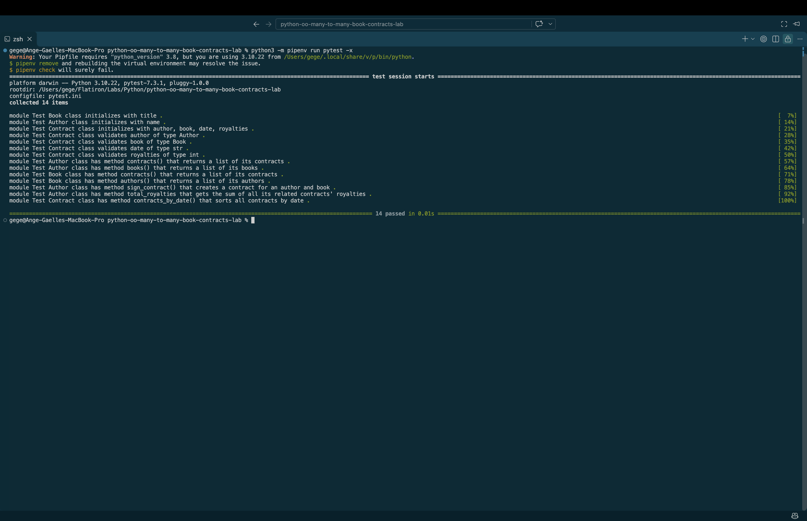

# Many-to-many Object Relationships Lab

Now that we have learned about several types of relationships it's time to build 
one of our own. In this lab you will be creating a many-to many relationship in 
python 

## The Scenario 

We are tasked with building a model to aid in building contracts for books with 
multiple authors. As a part of this model we need to create an Author model, a Book 
model and a Contract model. Authors can have many books through contracts, and books 
can have many authors through contacts.

## Tools & Resources 
- [Github Repo](https://github.com/learn-co-curriculum/python-oo-many-to-many-book-contracts-lab)
- [Python classes](https://docs.python.org/3/tutorial/classes.html)

## Instructions

### Task 1: Define the Problem

Build a model a many to many relationship between Books and Authors:

* Build Book class
* Build Author class
* Build Contract class
* Build connecting methods between all

### Task 2: Determine the Design

#### Book:
* Attributes:
  * title (string)
  * all (array) 
* Methods:
  * contracts()
  * authors()

#### Authors:
* Attributes:
  * name (string)
  * all (array)
* Methods:
  * contracts()
  * books()
  * sign_contracts(book,date,royalties)
  * total_royalties()

#### Contracts:
* Attributes:
  * author (Author class), 
  * book (Book class), 
  * date (string), 
  * royalties (integer)
  * all (array)
* Methods:
  * contracts_by_date()

### Task 3: Develop, Test, and Refine the Code

#### Step 1: Create feature branch

#### Step 2: Create Book class

* `__init__`: title
* Class attributes- all
* Methods:
  * contracts()- This method should return a list of related contracts
  * authors()- This method should return a list of related authors using the Contract class as an intermediary

#### Step 3: Authors

* `__init__`: name (string)
* Class attributes- all
* Methods:
  * contracts()- This method should return a list of related contracts
  * books()- This method should return a list of related books using the Contract class as an intermediary
  * sign_contracts(book,date,royalties)- This method should create and return a new Contract object between the author and the specified book with the specified date and royalties
  * total_royalties()- This method should return the total amount of royalties that the author has earned from all of their contracts

#### Step 4: Contracts

* `__init__`:
  * author
  * book
  * date 
  * royalties 
* Class attributes: all
* Properties: All properties should raise an exception if not valid
  * author: Is an instance of Author class
  * book:  Is an instance of Book class
  * date: Is an instance of a str
  * royalties:  Is an instance of an int
* Class Methods: contracts_by_date()- This method should return all contracts that have the same date as the date passed into the method

#### Step 6: Push feature branch and open a PR on GitHub

#### Step 7: Merge to main

### Task 4: Document and Maintain

Best Practice documentation steps:
* Add comments to the code to explain purpose and logic, clarifying intent and functionality of your code to other developers.
* Update README text to reflect the functionality of the application following https://makeareadme.com. 
  * Add screenshot of completed work included in Markdown in README.
* Delete any stale branches on GitHub
* Remove unnecessary/commented out code
* If needed, update git ignore to remove sensitive data

## Important Submission Note

Before you submit your solution, you need to save your progress with git.

* Add your changes to the staging area by executing git add .
* Create a commit by executing git commit -m "Your commit message"
* Push your commits to GitHub by executing git push origin main

## Classes and Attributes

### Author Class

The `Author` class represents an individual author.

| Attribute | Description |
|---|---|
| `name` | Stores the author's name. |
| `all` | Class attribute containing all Author objects. |

When a new author is created, the object is automatically added to `Author.all`.

### Book Class

The `Book` class represents an individual book.

| Attribute | Description |
|---|---|
| `title` | Stores the book's title. |
| `all` | Class attribute containing all Book objects. |

When a new book is created, the object is automatically added to `Book.all`.

### Contract Class

The `Contract` class represents an agreement between an author and a book.

| Attribute | Description |
|---|---|
| `author` | References an Author object. |
| `book` | References a Book object. |
| `date` | Stores the contract date as a string. |
| `royalties` | Stores the royalties as an integer. |
| `all` | Class attribute containing all Contract objects. |

Each new contract is added to `Contract.all`.

## Methods

### Author Methods

#### `__init__(name)`

Creates a new author, stores their name, and adds the author object to the shared list.

#### `contracts()`

Returns all contracts associated with the author.

The method uses a list comprehension to search `Contract.all`.

#### `books()`

Returns a list of books associated with the author.

The method uses `set()` to prevent duplicate books.

#### `sign_contracts(book, date, royalties)`

Creates a new contract connecting the author to a book.

The method accepts a book object, contract date, and royalty amount.

#### `total_royalties()`

Calculates the author's total royalties by adding the royalties from all their contracts.

The method uses Python's built-in `sum()` function.

### Book Methods

#### `__init__(title)`

Creates a new book, stores its title, and adds it to `Book.all`.

#### `contracts()`

Returns all contracts associated with the book.

The method searches the shared `Contract.all` list.

#### `authors()`

Returns all authors associated with the book.

The method uses `set()` to remove duplicate authors.

### Contract Methods

#### `__init__(author, book, date, royalties)`

Creates a new contract and stores the author, book, date, and royalties.

The contract is then added to `Contract.all`.

#### Property Getters and Setters

The `Contract` class uses `@property` and setter decorators to validate information.

The setters check that:

- `author` is an `Author` object.
- `book` is a `Book` object.
- `date` is a string.
- `royalties` is an integer.

Invalid values raise a `ValueError`.

#### `contracts_by_date(date)`

A class method that returns all contracts matching a given date.

The method uses `@classmethod` and searches `Contract.all`.

## Example Usage

The following example demonstrates how the classes work together.

```python
# Create authors
author1 = Author("Alice Smith")
author2 = Author("Bob Johnson")

# Create books
book1 = Book("Learning Python")
book2 = Book("Advanced Python")

# Create contracts
contract1 = author1.sign_contracts(book1, "2026-01-15", 1000)
contract2 = author1.sign_contracts(book2, "2026-02-20", 1500)
contract3 = author2.sign_contracts(book1, "2026-01-15", 800)

# View an author's books
print([book.title for book in author1.books()])
# ['Learning Python', 'Advanced Python']
# Order may vary

# View a book's authors
print([author.name for author in book1.authors()])
# ['Alice Smith', 'Bob Johnson']
# Order may vary

# Calculate total royalties
print(author1.total_royalties())
# 2500

# Find contracts by date
print(len(Contract.contracts_by_date("2026-01-15")))
# 2
```

This example demonstrates how multiple authors and books can be connected through contracts.

## Installation and Setup

### 1. Clone the Repository

```bash
git clone git@github.com:a-gbatie/python-oo-many-to-many-book-contracts-lab.git
```

### 2. Open the Project

Open the cloned project folder in Visual Studio Code.

### 3. Set Up Python 3.10

```bash
python3 -m pipenv --python /opt/homebrew/bin/python3.10
```

This command selects Python 3.10 for the Pipenv environment.

### 4. Install Dependencies

```bash
python3 -m pipenv install
```

## Running the Tests

To run all tests:

```bash
python3 -m pipenv run pytest
```

To stop at the first failing test:

```bash
python3 -m pipenv run pytest -x
```

## Screenshot of Completed Tests
